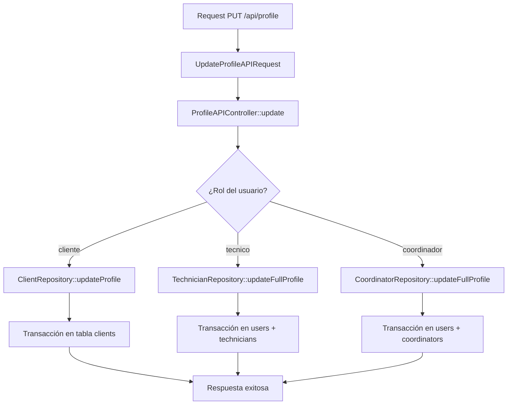

# 📋 Documentación API de Perfiles

## 🎯 Descripción General

Sistema de gestión de perfiles de usuario implementado con **patrón repositorio** que permite actualizar información específica según el rol del usuario (Cliente, Técnico, Coordinador).

## 🏗️ Arquitectura

### Patrón Repositorio Implementado

```
Controller → Repository → Model
    ↓           ↓          ↓
ProfileAPI  → ClientRepo → Client
Controller  → TechRepo   → Technician  
           → CoordRepo  → Coordinator
           → UserRepo   → User
```

## 📁 Estructura de Archivos

```
app/
├── Http/
│   ├── Controllers/Auth/
│   │   ├── ProfileAPIController.php    # Controlador principal
│   │   └── MeController.php            # Endpoint para obtener perfil
│   └── Requests/Auth/
│       └── UpdateProfileAPIRequest.php # Validaciones
├── Repositories/
│   ├── Client/ClientRepository.php     # Repositorio de clientes
│   ├── Technician/TechnicianRepository.php
│   ├── Coordinator/CoordinatorRepository.php
│   └── User/UserRepository.php
└── Models/
    ├── Client/Client.php
    ├── Technician/Technician.php
    ├── Coordinator/Coordinator.php
    └── User.php
```

## 🚀 Endpoints

### 1. Obtener Perfil del Usuario
```http
GET /api/me
Authorization: Bearer {token}
```

**Respuesta:**
```json
{
  "message": "Usuario obtenido correctamente.",
  "data": {
    "id": 1,
    "name": "Usuario",
    "email": "usuario@ejemplo.com",
    "role": "cliente",
    "policy_accepted": true,
    "client_data": {
      "identifier": "CLI001",
      "name": "Cliente Ejemplo",
      "address": "Dirección",
      "city": "Ciudad",
      "phone": "123456789",
      "status": "active",
      "devices_count": 5,
      "contacts_count": 3
    }
  }
}
```

### 2. Actualizar Perfil del Usuario
```http
PUT /api/profile
Authorization: Bearer {token}
Content-Type: application/json

{
  "name": "Nuevo Nombre",
  "email": "nuevo@email.com",
  "phone": "123456789",
  "address": "Nueva Dirección",
  "city": "Nueva Ciudad",
  "document": "12345678"
}
```

**Respuesta:**
```json
{
  "message": "Perfil actualizado correctamente.",
  "success": true
}
```

## 🔧 Implementación por Rol

### Cliente (`cliente`)
- **Tabla actualizada:** `clients`
- **Campos actualizables:**
  - `name` - Nombre del cliente
  - `email` - Email del cliente
  - `address` - Dirección
  - `city` - Ciudad
  - `phone` - Teléfono
  - `document` - Se convierte a `identifier`

### Técnico (`tecnico`)
- **Tablas actualizadas:** `users` + `technicians`
- **En `users`:**
  - `name` - Nombre del usuario
  - `email` - Email del usuario
- **En `technicians`:**
  - `document` - Documento del técnico
  - `phone` - Teléfono
  - `address` - Dirección

### Coordinador (`coordinador`)
- **Tablas actualizadas:** `users` + `coordinators`
- **En `users`:**
  - `name` - Nombre del usuario
  - `email` - Email del usuario
- **En `coordinators`:**
  - `identification` - Identificación del coordinador
  - `phone` - Teléfono
  - `address` - Dirección

## 🏛️ Repositorios

### ClientRepository
```php
class ClientRepository extends BaseRepository
{
    // Obtener cliente por user_id
    public function getClientByUserId(int $id): ?Client
    
    // Actualizar perfil de cliente (con transacción)
    public function updateProfile(int $userId, array $attributes): Client
}
```

### TechnicianRepository
```php
class TechnicianRepository extends BaseRepository
{
    // Obtener técnico por user_id
    public function getTechnicianByUserId(int $userId): ?Technician
    
    // Actualizar solo datos del técnico
    public function updateProfile(int $userId, array $attributes): Technician
    
    // Actualizar usuario + técnico en una transacción
    public function updateFullProfile(int $userId, array $userAttributes, array $technicianAttributes): array
}
```

### CoordinatorRepository
```php
class CoordinatorRepository extends BaseRepository
{
    // Obtener coordinador por user_id
    public function getCoordinatorByUserId(int $userId): ?Coordinator
    
    // Actualizar solo datos del coordinador
    public function updateProfile(int $userId, array $attributes): Coordinator
    
    // Actualizar usuario + coordinador en una transacción
    public function updateFullProfile(int $userId, array $userAttributes, array $coordinatorAttributes): array
}
```

### UserRepository
```php
class UserRepository extends BaseRepository
{
    // Actualizar datos básicos del usuario
    public function updateProfile(int $userId, array $attributes): User
}
```

## 🎛️ Controlador

### ProfileAPIController
```php
class ProfileAPIController extends Controller
{
    public function __construct(
        private UserRepository $userRepository,
        private ClientRepository $clientRepository,
        private TechnicianRepository $technicianRepository,
        private CoordinatorRepository $coordinatorRepository
    ) {}

    public function update(UpdateProfileAPIRequest $request): JsonResponse
    {
        // Lógica de delegación según rol
        switch ($user->role) {
            case 'cliente':
                $this->clientRepository->updateProfile($user->id, $clientData);
                break;
            case 'tecnico':
                $this->technicianRepository->updateFullProfile($user->id, $userData, $technicianData);
                break;
            case 'coordinador':
                $this->coordinatorRepository->updateFullProfile($user->id, $userData, $coordinatorData);
                break;
        }
    }
}
```

## ✅ Validaciones

### UpdateProfileAPIRequest
```php
public function rules(): array
{
    $rules = [
        'name' => 'sometimes|string|max:255',
        'email' => 'sometimes|email|max:255|unique:users,email,' . $user->id,
        'phone' => 'sometimes|string|max:20',
        'address' => 'sometimes|string|max:255',
        'city' => 'sometimes|string|max:255',
    ];

    // Reglas específicas por rol
    switch ($user->role) {
        case 'cliente':
        case 'tecnico':
            $rules['document'] = 'sometimes|string|max:20';
            break;
        case 'coordinador':
            $rules['identification'] = 'sometimes|integer|unique:coordinators,identification,' . ($user->coordinator?->id ?? 'NULL');
            break;
    }

    return $rules;
}
```

## 🔄 Transacciones

### Manejo Automático
- ✅ Cada repositorio maneja sus propias transacciones
- ✅ Rollback automático en caso de error
- ✅ No hay que manejar `DB::beginTransaction()` manualmente

```php
// En cada repositorio
public function updateProfile(int $userId, array $attributes): Model
{
    return \DB::transaction(function () use ($userId, $attributes) {
        // Lógica de actualización
        // Rollback automático si falla
    });
}
```

## 🧪 Testing

### Ejemplo de Test
```php
public function test_update_client_profile()
{
    $user = User::factory()->create(['role' => 'cliente']);
    $client = Client::factory()->create(['user_id' => $user->id]);
    
    $response = $this->putJson('/api/profile', [
        'name' => 'Nuevo Nombre',
        'email' => 'nuevo@email.com',
        'phone' => '123456789'
    ]);
    
    $response->assertStatus(200);
    $this->assertDatabaseHas('clients', [
        'id' => $client->id,
        'name' => 'Nuevo Nombre',
        'email' => 'nuevo@email.com'
    ]);
}
```

## 🚨 Manejo de Errores

### Errores Comunes
- **400 Bad Request:** Datos de validación inválidos
- **404 Not Found:** Usuario no encontrado
- **500 Internal Server Error:** Error en la base de datos

### Respuestas de Error
```json
{
  "message": "Error al actualizar el perfil: No se encontró el perfil del cliente",
  "success": false
}
```

## 📊 Ventajas del Patrón Repositorio

1. **🔒 Separación de Responsabilidades**
   - Controlador: Solo lógica de negocio
   - Repositorio: Acceso a datos y transacciones
   - Modelo: Estructura de datos

2. **🧪 Testabilidad**
   - Fácil mockear repositorios
   - Tests más rápidos y aislados
   - Controlador más simple de testear

3. **🔄 Reutilización**
   - Métodos de repositorio reutilizables
   - Lógica centralizada
   - Código más mantenible

4. **🛡️ Consistencia**
   - Transacciones automáticas
   - Rollback automático
   - Manejo de errores centralizado

## 🎯 Flujo de Actualización



## 🔧 Configuración de Rutas

```php
// routes/api.php
Route::put('/profile', ProfileAPIController::class . '@update');
Route::get('/me', MeController::class . '@me');
```

## 📝 Notas Importantes

- ✅ Las transacciones están encapsuladas en los repositorios
- ✅ No hay que manejar `DB::commit()` o `DB::rollBack()` manualmente
- ✅ Cada rol tiene su lógica específica de actualización
- ✅ Validaciones automáticas según el rol del usuario
- ✅ Manejo de errores centralizado y consistente

---

**Desarrollado con Laravel + Patrón Repositorio** 🚀
